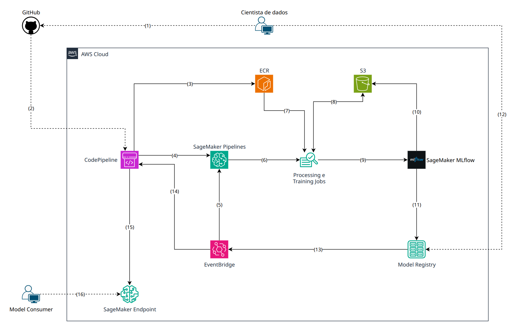

# Desenho de arquitetura em produção na AWS

> [!NOTE]
> O desenho assume uma versão do mlbox compatível com o SageMaker, que ainda não existe. Hoje a ferramenta só se baseia nos conceitos dele: os contratos de container não são seguidos à risca, o `data_path` é um diretório local e o `Runner` não traduz o pipeline para o SageMaker Pipelines. Isso está em [O que faria diferente com mais tempo](DECISIONS.md#o-que-faria-diferente-com-mais-tempo).

## Descrição de componentes

- **GitHub**: repositório do projeto do cientista (`pipeline.py` e `requirements.txt`). É só um exemplo, poderia ser qualquer outro.
- **CodePipeline**: CI/CD. Usa o CodeBuild para construir a imagem e publicar o pipeline, e faz o deploy do endpoint. Poderia ser o GitHub Actions, por exemplo.
- **ECR**: imagens dos pipelines (imagem base do mlbox mais o `requirements.txt`).
- **SageMaker Pipelines**: orquestra o grafo de steps, no lugar do `Runner`.
- **Processing e Training Jobs**: cada step roda em um job, em um container e uma instância próprios.
- **S3**: dados de treino, arquivos trocados entre steps (no lugar do `data_path`) e artefatos do MLflow.
- **SageMaker MLflow**: MLflow gerenciado, para tracking (parâmetros, seed, métricas e status dos steps) e registry.
- **Model Registry**: versões dos modelos, sincronizadas do MLflow, com status de aprovação.
- **EventBridge**: agenda as execuções do pipeline e reage à aprovação de um modelo.
- **SageMaker Endpoint**: a API de inferência, rodando a mesma imagem do treino.
- **Model Consumer**: qualquer sistema que usa as predições do modelo.

## Descrição de relacionamentos

1. O cientista faz push do projeto no GitHub.
2. O push dispara o CodePipeline.
3. O CodeBuild constrói a imagem do pipeline e publica no ECR.
4. O CodePipeline traduz o `Pipeline` do mlbox para uma definição do SageMaker Pipelines e faz o upsert dela.
5. O EventBridge inicia as execuções agendadas. O cientista também pode iniciar uma execução sob demanda, pela CLI do mlbox ou pelo SageMaker Studio.
6. O SageMaker Pipelines roda cada step como um Processing ou Training Job[1], e steps independentes rodam em paralelo[2][3].
7. Os jobs fazem pull da imagem do ECR.
8. Os jobs leem os dados de treino do S3 e trocam arquivos entre steps por um prefixo da execução no S3[4].
9. Os jobs registram parâmetros, métricas e o modelo no MLflow.
10. O MLflow guarda os artefatos, incluindo o modelo, no S3.
11. O modelo registrado no MLflow é sincronizado com o Model Registry, com status pendente de aprovação.
12. O cientista acompanha as execuções e as métricas na UI do MLflow e aprova ou rejeita o modelo no Model Registry[5].
13. A aprovação gera um evento no EventBridge.
14. O evento dispara o deploy no CodePipeline.
15. O CodePipeline cria ou atualiza o endpoint, com a mesma imagem do treino e o modelo aprovado no S3[6].
16. O Model Consumer chama o endpoint para obter predições[7].

**NOTAS**:

- [1]: Processing Jobs servem para pré-processamento e avaliação, e Training Jobs para o treino. O `@step` do mlbox poderia declarar o tipo, com Training Job como padrão, que é o que o `@step` do próprio SageMaker usa por baixo.
- [2]: O cientista continua declarando `cpus` e `memory` no `@step`, e a plataforma traduz isso para um `instance_type` com uma tabela simples. Quem escolhe a família de instância é a plataforma, não o cientista.
- [3]: O SageMaker Pipelines já traz retries, cache de steps e condições (`ConditionStep`), que ficaram fora do escopo da versão local.
- [4]: Ler os dados do S3 é só um exemplo. O primeiro step poderia ler de qualquer data lake ou warehouse, ou do Feature Store do SageMaker.
- [5]: A aprovação também poderia ser automática, por exemplo com um step no final do pipeline que compara as métricas com as do modelo em produção. De qualquer forma, ela substitui o "serve a última versão" da versão local.
- [6]: Um endpoint com imagem própria precisa expor `/ping` e `/invocations` na porta 8080, o que faz parte da compatibilidade citada no início. O modelo vem do S3, então o endpoint não depende do MLflow para subir.
- [7]: Não me apeguei a detalhes de rede, porque o consumo pode acontecer de várias formas. Logs e métricas dos jobs e do endpoint vão para o CloudWatch, que ficou de fora do desenho.
