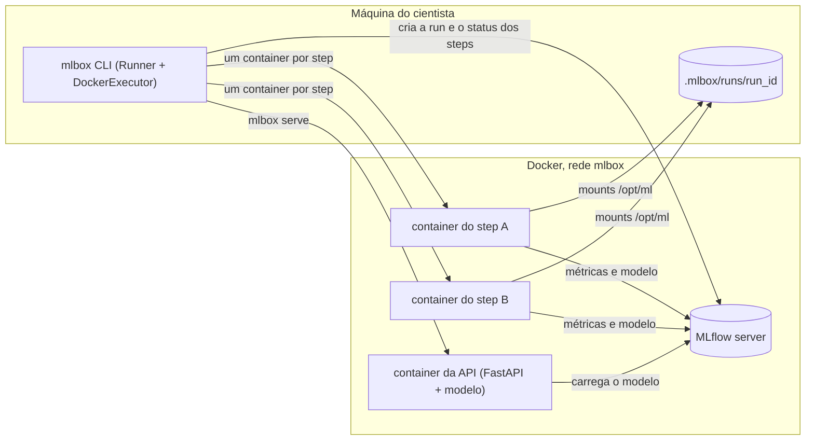

# Arquitetura da library

O `mlbox` é uma library Python com três partes:

- **SDK**: o que o cientista importa no pipeline (`step`, `Pipeline`, `get_context`).
- **CLI**: o que ele roda na máquina dele (`mlbox run`, `list`, `show`, `serve`).
- **Worker e API**: o que roda dentro dos containers (`python -m mlbox.worker` para os steps e `mlbox.serving:app` para a API).

## Módulos

| Módulo | Responsabilidade |
| --- | --- |
| [step.py](../src/mlbox/step.py) | `@step`, `Step` e `StepOutput` (a referência ao retorno futuro de um step). Valida que os argumentos são JSON |
| [pipeline.py](../src/mlbox/pipeline.py) | `Pipeline`, que monta o grafo a partir das referências, e `load_pipeline`, que importa o arquivo do pipeline |
| [context.py](../src/mlbox/context.py) | `Context`, `get_context()` e `register_model` |
| [runner.py](../src/mlbox/runner.py) | `Runner`, que decide quando cada step roda, e o protocolo `Executor`, que define onde ele roda |
| [docker.py](../src/mlbox/docker.py) | `DockerExecutor`, build da imagem do pipeline e `serve_model` |
| [worker.py](../src/mlbox/worker.py) | Entrypoint dos containers dos steps |
| [tracking.py](../src/mlbox/tracking.py) | Todo o acesso ao MLflow: runs, status dos steps e versões de modelos |
| [serving.py](../src/mlbox/serving.py) | A API FastAPI |
| [main.py](../src/mlbox/main.py) | A CLI (Typer) |

## Definição do pipeline

Chamar um `Step` não executa a função, só guarda os argumentos e retorna um `StepOutput`. Um `StepOutput` passado como argumento para outro step vira uma dependência. O `Pipeline` recebe os steps finais e percorre as dependências até o início, então o grafo fica pronto sem rodar código de step nenhum. Com isso o mesmo arquivo pode ser importado na máquina do cientista (para montar o grafo) e dentro de cada container (para rodar um step).

## Execução: `mlbox run`

1. `load_pipeline` importa o arquivo e encontra o único `Pipeline` dele.
2. Os parâmetros (`-p`) são validados com o `BaseModel` do pipeline. Se falhar, a CLI sai sem criar run.
3. `build_pipeline_image` cria a imagem do pipeline: `FROM mlbox:latest` mais o `requirements.txt`. A tag é `mlbox-<pipeline>:<hash>`, com o hash calculado a partir do requirements e do ID da imagem base, então ela é reaproveitada enquanto nenhum dos dois muda. Sem requirements, usa a `mlbox:latest`.
4. `Runner.run` cria a run no MLflow e o diretório `.mlbox/runs/<run_id>/data`.
5. O `Runner` manda para um thread pool todo step cujas dependências já terminaram com sucesso, trocando as referências nos argumentos pelos valores retornados. Cada thread fica esperando o container do seu step, e o loop continua conforme os steps terminam.
6. `DockerExecutor.execute` escreve a configuração do step, sobe o container com os limites de CPU e memória, mostra os logs com o nome do step como prefixo e, no final, lê o `result.json` ou o `failure`.
7. Dentro do container, o worker importa o pipeline, valida os parâmetros, monta o `Context`, aplica a seed, retoma a run do MLflow e chama a função do step.
8. Se um step falha, nenhum step novo começa, os que estão rodando terminam, os pendentes ficam `skipped` e a run termina `FAILED`.

O `Runner` não sabe nada de Docker, ele só chama `Executor.execute(job)`. Nos testes ele roda com um executor fake, e em produção daria para ter outro executor (SageMaker, Kubernetes) sem mudar o resto.

## Contrato do container dos steps

Baseado no layout `/opt/ml` do SageMaker.

| Caminho | Conteúdo |
| --- | --- |
| `/opt/ml/code` | Diretório do projeto, somente leitura. É o working directory |
| `/opt/ml/input/config/hyperparameters.json` | Os parâmetros do pipeline |
| `/opt/ml/input/config/step.json` | Nome do step, argumentos já resolvidos, seed e ID da run |
| `/opt/ml/data` | Diretório compartilhado da execução (`ctx.data_path`) |
| `/opt/ml/output/result.json` | Escrito em caso de sucesso, com o retorno do step |
| `/opt/ml/output/failure` | Escrito em caso de falha, com o erro e o traceback |

Na máquina do cientista tudo fica em `.mlbox/runs/<run_id>/`: `data/` e, para cada step, `steps/<step>/config` e `steps/<step>/output`. Os containers rodam com o UID/GID do usuário, para os arquivos não ficarem com o root.

## Tracking

O MLflow guarda tanto o tracking quanto o estado das execuções, então `list` e `show` leem tudo de lá.

- Cada execução é uma run, em um experimento com o nome do pipeline. O run ID do MLflow é o run ID do mlbox.
- Os parâmetros e a seed (`random_seed`) são params da run.
- O status da run é `RUNNING` e depois `FINISHED` ou `FAILED`. O status de cada step (`pending`, `running`, `succeeded`, `failed`, `skipped`) fica na tag `mlbox.step.<nome>.status`.
- A tag `mlbox.pipeline` identifica as runs criadas pelo mlbox, e a tag `mlbox.image` guarda a imagem em que os steps rodaram.
- O worker retoma a run criada pelo `Runner` (`mlflow.start_run(run_id=...)`) e deixa ela como `RUNNING` no final, porque o status final é responsabilidade do `Runner`. Assim qualquer `mlflow.log_*` do cientista cai na run certa.

A CLI acessa o MLflow em `MLFLOW_TRACKING_URI` (padrão `http://localhost:5001`) e os containers pela rede `mlbox`, em `MLBOX_CONTAINER_TRACKING_URI` (padrão `http://mlflow:5000`).

## Serving: `mlbox serve`

1. `get_model_version` busca a versão pedida (ou a de maior número), a run que a treinou e a tag `mlbox.image` dessa run. Se o modelo, a versão, a tag ou a imagem não existirem, a CLI sai com erro sem subir container.
2. `serve_model` sobe um container dessa imagem rodando `uvicorn mlbox.serving:app` na porta 8080, com o modelo e a versão em `MLBOX_MODEL_NAME` e `MLBOX_MODEL_VERSION`. Ctrl+C para e remove o container.
3. No lifespan, a API carrega `models:/<nome>/<versão>` com `mlflow.pyfunc`, guarda o schema e o exemplo de input, e coloca o exemplo no OpenAPI do `/predict`.
4. Os endpoints recebem o modelo por uma dependency do FastAPI (`Depends(get_model)`), o que facilita os testes. O `/predict` é síncrono para o FastAPI rodá-lo no threadpool e a inferência, que usa CPU, não bloquear o event loop. `/health` e `/info` são async.

A validação do input fica com o schema enforcement do MLflow, que vira HTTP 422. A API só faz duas coisas antes:

- Checa se toda instância tem as features obrigatórias, porque montar um DataFrame com várias instâncias preenche a feature que falta com nulo e o MLflow não reclama.
- Converte inteiros para float nas features `double`, porque o JSON não diferencia `5` de `5.0` e o MLflow rejeita `int64` em uma coluna `double`.

## Execução com docker compose

O `make up` roda o fluxo inteiro sem precisar instalar nada além de Docker e make:

- `mlflow`: o servidor do MLflow, com sqlite e artefatos em um volume.
- `model-training`: roda `mlbox run examples/iris/pipeline.py` em um container com o socket do Docker montado. Os containers dos steps são criados pelo daemon do host, como irmãos desse container. Por isso o projeto é montado no mesmo caminho do host: o daemon resolve os mounts dos steps no host.
- `model-serving`: espera o treino terminar com sucesso e roda `mlbox serve --model iris`. Usa `stop_signal: SIGINT` porque o `mlbox serve` só remove o container da API no Ctrl+C.

O Makefile passa o UID/GID do usuário para os containers, para os arquivos em `.mlbox` não ficarem com o root. O GID do socket do Docker é lido de dentro de um container, porque no Docker Desktop (macOS) o socket é o da VM, não o do Mac.
